

  

  <a href="https://github.com/IslamElawdy/zayyin/releases/latest/download/Zayyin-windows-setup.exe">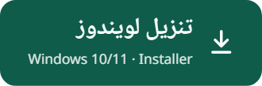</a>
  <a href="https://github.com/IslamElawdy/zayyin/releases/latest/download/Zayyin-android.apk">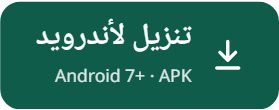</a>
  

  
  
  

  <a href="#ar"><b>العربية</b></a> &nbsp;·&nbsp; <a href="#en"><b>English</b></a> &nbsp;·&nbsp; <a href="#de"><b>Deutsch</b></a>

## زيِّن… تعلَّم التجويد من المصحف نفسه

يعرض **زيِّن** القرآنَ الكريم برواية حفص عن عاصم، وأحكامُ التجويد ملوّنةٌ على الحروف التي تقع فيها.
اضغط على أي كلمة، يُخبرك: ما الحكم؟ ولماذا هنا؟ وكيف يُقرأ؟ ثم استمع إليها، أو اقرأ ويتابعك التطبيق.

الاسم من الحديث الشريف: «زيِّنوا القرآنَ بأصواتكم».

  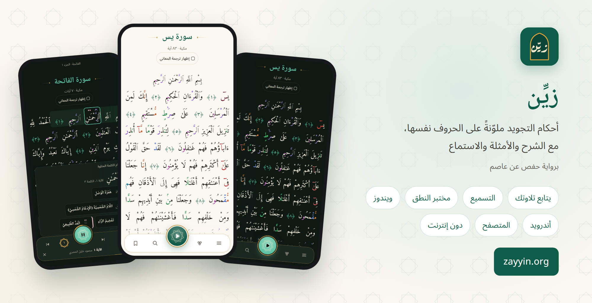

<table dir="rtl">
  <tr>
    <td align="center" width="25%">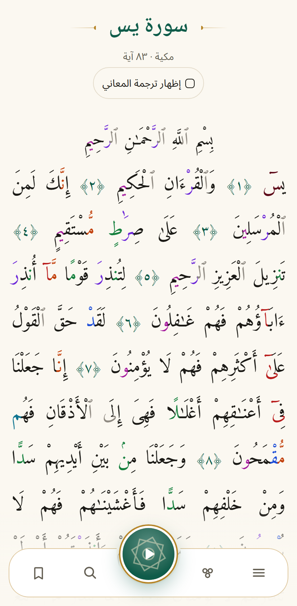</td>
    <td align="center" width="25%">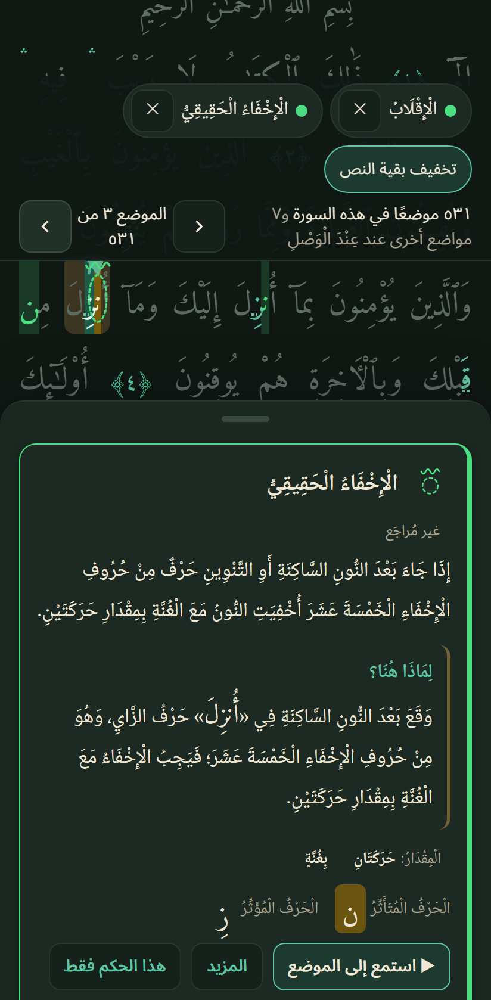</td>
    <td align="center" width="25%">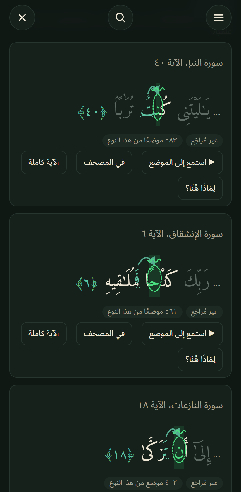</td>
    <td align="center" width="25%">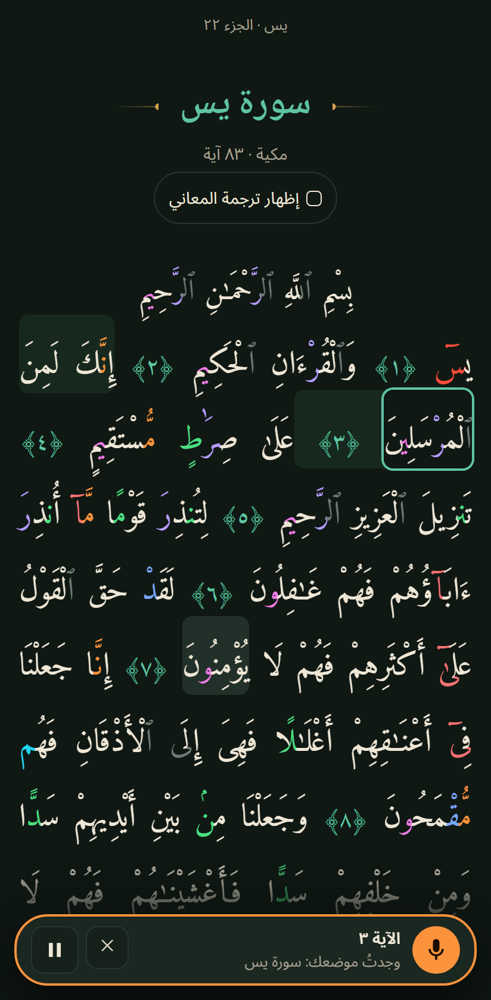</td>
  </tr>
  <tr>
    <td align="center"><b>اقرأ</b> الأحكام ملوّنة على الحروف</td>
    <td align="center"><b>افهم</b> «لِمَاذَا هُنَا؟» لكل موضع</td>
    <td align="center"><b>تدرّب</b> أمثلة كل حكم ومواضعه</td>
    <td align="center"><b>اتلُ</b> ويتابعك التطبيق كلمةً كلمة</td>
  </tr>
</table>

<table dir="rtl">
  <tr>
    <td align="center" width="50%">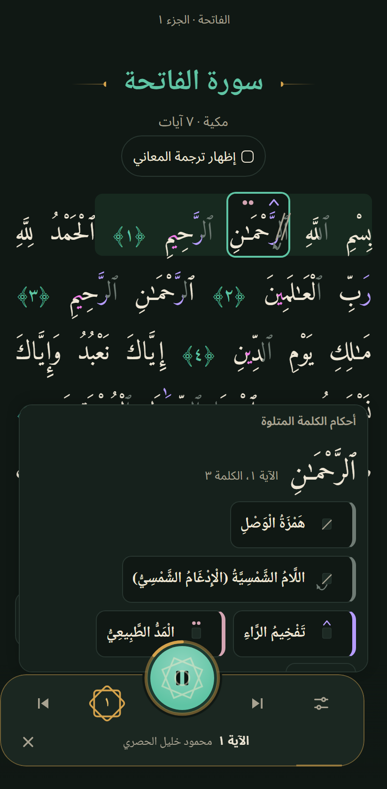</td>
    <td align="center" width="50%">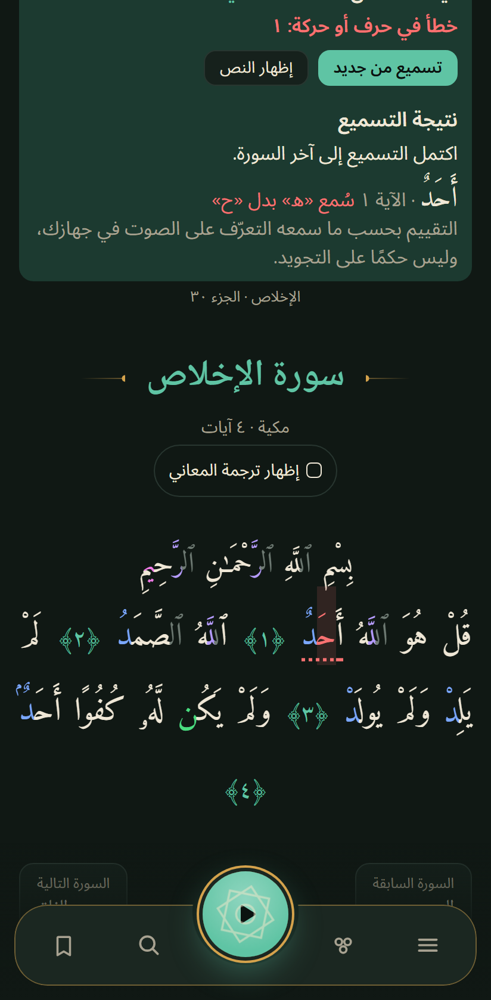</td>
  </tr>
  <tr>
    <td align="center"><b>استمع</b> النجمة: تابِع · استمع · سمِّع</td>
    <td align="center"><b>سمِّع</b> من حفظك، والأخطاء كلمةً كلمة</td>
  </tr>
</table>

### 📖 اقرأ وافهم

- **الأحكام على الحروف نفسها:** سبع عائلات ألوان، وعلامات فوق الحروف، في الوقف والوصل.
- **«لِمَاذَا هُنَا؟»:** الحكم، والحرف المؤثِّر والمتأثِّر، وسبب الحكم في هذا الموضع بالذات.
- **إبراز أحكام مختارة:** اختر حكمًا أو أكثر، فيُبرَز وحده في النص، وتنقّل من موضع إلى موضع.
- **أمثلة كل حكم:** أمثلة متنوعة مختارة، وجميع المواضع في السورة أو الجزء أو القرآن كله.
- **التحليل التجويدي للآية:** تحليل الموضع، وشرح الحكم، والحالات الخاصة، والوقف والوصل، وكيفية الأداء، وشجرة
  الأحكام — بمستوى مبسّط أو تفصيلي أو متقدم.
- **البحث المتقدم في أحكام التجويد** (ويندوز والمتصفح): اختر حكمًا، وحدّد ما قبله وما بعده من حروف وحركات،
  فتظهر مواضعه في القرآن كله.
- **التفسير والإعراب** والبحث في القرآن.

### 🎧 استمع وتابع

- **النجمة في الشريط السفلي** تفتح الطرق الثلاثة: **تابِع · استمع · سمِّع**.
- **الاستماع** إلى الآية، أو الصفحة، أو إلى آخر السورة، أو السورة كاملة، أو الجزء، أو من آية إلى آية — وإلى الكلمة
  أو الموضع نفسه. السرعة من ٠٫٥ إلى ١٫٧٥، مع تكرار كل آية وتكرار المقطع كله. ١٧ تلاوة لـ١٣ قارئًا، والحصري
  افتراضيًّا. وتظهر أحكام الكلمة المتلوّة على حروفها أثناء الاستماع.
- **«تابِع تلاوتي»:** اقرأ من حفظك أو من المصحف، من أي سورة. يجد التطبيق موضعك بعد كلمات قليلة، ويُبرز الكلمة
  التي تقرؤها، ويمرّر النص معك. **الصوت لا يغادر جهازك:** يُعالَج دون إنترنت، ولا يُحفظ ولا يُرسَل.
  المتابعة تتبّع الموضع فقط، ولا تحكم على التجويد.
- **التسميع:** يُخفى النص كله، فتقرأ من حفظك من أول السورة أو من موضعك، ولا يظهر إلا ما قرأتَه. الكلمة المتروكة تبقى
  مخفية ومعلَّمة، والخطأ في حرف أو حركة يُلوَّن في كلمته ويُذكر في النتيجة، و«أظهر الكلمة التالية» عند الحاجة.

### 👄 مختبر النطق (ويندوز والمتصفح)

- رأس ثلاثي الأبعاد يُريك **مخرج كل حرف** وحركة اللسان والشفتين والحلق خطوةً خطوة، مع **الصفات** ومصدرها.
- من أي كلمة في المصحف إلى نطق حرفها، والمقارنة بين حرفين جنبًا إلى جنب، ومقدار المدّ كما يقتضيه الموضع.
- معاينة تطويرية لم يراجعها أهل العلم بعدُ.

### 🌙 احفظ وواظب

- **خطة الحفظ:** وِرد جديد كل يوم ومراجعة لما حفظت، مع تذكير بموعد الوِرد.
- **العلامات ومتابعة القراءة:** تعود إلى حيث توقفت.
- **المزامنة بين أجهزتك** بمفتاح مزامنة وحده، دون بريد ولا اسم.
- **القبلة:** الاتجاه بدقة من موقعك، مع البوصلة على الجوال. يُحسب على جهازك، ولا يُحفظ الموقع ولا يُرسَل.

**وللجميع:** القرآن كاملًا دون إنترنت (الصوت وحده يُحمَّل عند التشغيل) · الوضع الداكن أو الفاتح · العربية وEnglish
وDeutsch · تصميم جديد بحركة هادئة (تقلّ إن طلب الجهاز ذلك) · شريط كبير ثابت في تطبيق أندرويد يناسب كبار السن ·
**مجاني، بلا إعلانات ولا تتبّع.**

  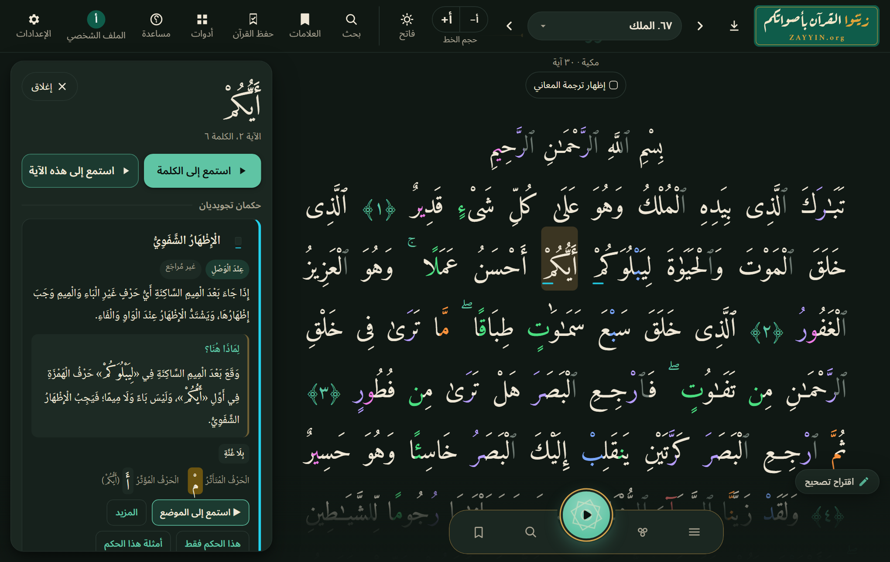 
  على الحاسوب: النص وشرح الكلمة جنبًا إلى جنب

  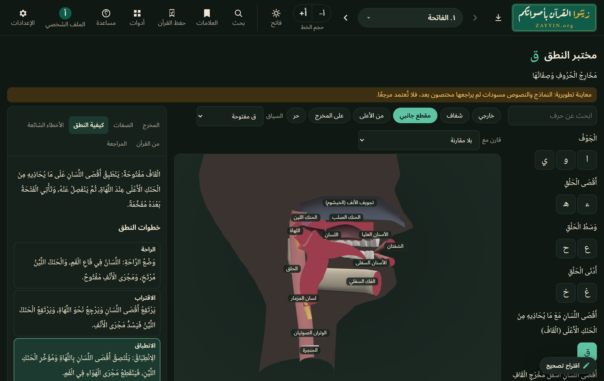 
  مختبر النطق: مخرج القاف ثلاثي الأبعاد

## التنزيل

| الجهاز | الملف | ملاحظة |
|---|---|---|
| **ويندوز ١٠ / ١١** | [`Zayyin-windows-setup.exe`](https://github.com/IslamElawdy/zayyin/releases/latest/download/Zayyin-windows-setup.exe) | لا يحتاج صلاحيات المدير. إن ظهر «Windows protected your PC»: *More info ← Run anyway* (البرنامج غير موقَّع بشهادة تجارية). |
| **أندرويد ٨ أو أحدث** | [`Zayyin-android.apk`](https://github.com/IslamElawdy/zayyin/releases/latest/download/Zayyin-android.apk) | افتح الملف، واسمح بالتثبيت من هذا المصدر عند السؤال. |
| **أي متصفح** | [zayyin.org](https://zayyin.org) | ومن زر التنزيل في الموقع: احفظ القرآن كاملًا للاستعمال دون إنترنت، أو ثبّت الموقع كتطبيق. |

تتحدّث التطبيقات المثبّتة تلقائيًّا.

> [!NOTE]
> مواضع التجويد مولَّدة آليًّا من النص، ولم يراجعها أهل العلم بعدُ. إن وجدتَ خطأً فاضغط «اقتراح تصحيح» في التطبيق،
> أو راسلنا (العنوان في [البيانات القانونية](https://zayyin.org/#/legal)).

هذا العمل لوجه الله تعالى، ولمن أراد أن يتعلّم تلاوة القرآن بسهولة. نسأل الله أن يتقبّله وينفع به.

---

## English

**Zayyin** shows the Qur'an (Ḥafṣ ʿan ʿĀṣim) with the tajwīd rules coloured on the very letters they apply to. Tap any
word to see which rule it is, why it applies here and how it sounds; then listen to it, or recite and let the app
follow you. The name comes from the hadith *“Beautify the Qur'an with your voices.”*

- **Read & understand:** seven colour families and signs on the letters, in pause and in continuous reading ·
  *“Why here?”* for every place · highlight chosen rules and step from place to place · varied examples for each
  rule and all its places in a surah, a juzʾ or the whole Qur'an · *tajwīd analysis of the ayah* (the place, the rule,
  special cases, stopping and reading on, pronunciation, the rule tree; simple, detailed or advanced) · *advanced tajwīd
  search* (Windows and browser): a rule with the letters and vowels before and after it, across the whole Qur'an · tafsir, grammar (iʿrāb) and
  search.
- **Listen & recite:** the star in the bottom bar opens three ways — *Follow · Listen · Recite from memory* · 17
  recordings by 13 reciters (al-Ḥuṣarī by default) for an ayah, a page, to the end of the surah, the whole surah, a juzʾ
  or any range, a word or a single place; speed 0.5–1.75×, repeat each ayah and the whole passage · *Follow my
  recitation:* recite from memory or from the text, from any surah; the app finds your place and highlights the word you
  are at. The audio never leaves your device. It follows your place and does not judge your tajwīd · *Recite from
  memory (tasmīʿ):* the text is hidden and only what you recite appears; a word left out stays hidden and is marked, a
  wrong letter or vowel is coloured in its word and named in the result.
- **Articulation studio** (Windows and browser): a 3D head shows where each letter is articulated and how tongue, lips
  and throat move, step by step, with its characteristics (ṣifāt) and their source; from any word of the Qur'an to its
  letter, two letters side by side. A development preview, not yet reviewed by scholars.
- **Memorise & keep going:** a daily hifz plan with new pages and review, and a reminder · bookmarks and
  “continue reading” · sync between your devices with a sync key alone, no email, no name · Qibla direction, computed on
  your device.
- The whole Qur'an works offline (only the audio is loaded when played) · dark or light · a new design with calm
  motion (less when the device asks for it) · Arabic, English, German · **free, no ads, no tracking.**

| Device | Download |
|---|---|
| Windows 10 / 11 | [`Zayyin-windows-setup.exe`](https://github.com/IslamElawdy/zayyin/releases/latest/download/Zayyin-windows-setup.exe): no admin rights needed. If Windows shows “Windows protected your PC”: *More info → Run anyway* (the app is not commercially signed). |
| Android 8 or newer | [`Zayyin-android.apk`](https://github.com/IslamElawdy/zayyin/releases/latest/download/Zayyin-android.apk): open it and allow installing from this source. |
| Any browser | [zayyin.org](https://zayyin.org): can also save the whole Qur'an for offline use. |

> [!NOTE]
> The tajwīd places are generated automatically and have not yet been reviewed by scholars. Found a mistake? Use
> “Suggest a correction” in the app.

---

## Deutsch

**Zayyin** zeigt den Qur'an (Ḥafṣ ʿan ʿĀṣim) mit den Tajwīd-Regeln farbig auf genau den Buchstaben, auf die sie
sich beziehen. Ein Tipp auf ein Wort zeigt die Regel, warum sie hier gilt und wie es klingt. Danach kann man es
anhören oder selbst rezitieren, und die App liest mit. Der Name stammt aus dem Hadith *„Schmückt den Qur'an mit
euren Stimmen.“*

- **Lesen & verstehen:** sieben Farbfamilien und Zeichen auf den Buchstaben, beim Anhalten und im Fluss ·
  *„Warum hier?“* zu jeder Stelle · gewählte Regeln hervorheben und von Stelle zu Stelle springen · Beispiele zu
  jeder Regel und alle ihre Stellen in einer Sure, einem Juzʾ oder im ganzen Qur'an · *Tajwīd-Analyse der Āya*
  (die Stelle, die Regel, Sonderfälle, Anhalten und Weiterlesen, Aussprache, Regelbaum; einfach, ausführlich oder
  fortgeschritten) · *erweiterte Tajwīd-Suche* (Windows und Browser): eine Regel mit den Buchstaben und Vokalen davor und danach, im ganzen
  Qur'an · Tafsīr, Grammatik (Iʿrāb) und Suche.
- **Anhören & rezitieren:** der Stern in der unteren Leiste öffnet drei Wege — *Folgen · Anhören · Aufsagen* · 17
  Aufnahmen von 13 Rezitatoren (al-Ḥuṣarī als Standard) für eine Āya, eine Seite, bis zum Surenende, die ganze Sure,
  einen Juzʾ, einen beliebigen Bereich, ein Wort oder eine einzelne Stelle; Tempo 0,5–1,75×, jede Āya und den ganzen
  Abschnitt wiederholen · *Rezitation verfolgen:* aus dem Gedächtnis oder vom Text, aus jeder Sure. Die App findet die
  Stelle und markiert das gerade gelesene Wort. Der Ton verlässt das Gerät nie. Die App verfolgt nur die Stelle und
  bewertet kein Tajwīd · *Aufsagen (Tasmīʿ):* der Text ist verdeckt, nur das Rezitierte erscheint; ein ausgelassenes
  Wort bleibt verdeckt und wird markiert, ein falscher Buchstabe oder Vokal wird im Wort gefärbt und im Ergebnis genannt.
- **Artikulationsstudio** (Windows und Browser): ein 3D-Kopf zeigt, wo jeder Buchstabe gebildet wird und wie sich
  Zunge, Lippen und Rachen bewegen, Schritt für Schritt, mit den Eigenschaften (Ṣifāt) und ihrer Quelle; von jedem Wort
  des Qur'an zu seinem Buchstaben, zwei Buchstaben nebeneinander. Eine Entwicklungsvorschau, noch nicht von Gelehrten
  geprüft.
- **Auswendig lernen & dranbleiben:** täglicher Ḥifẓ-Plan mit neuen Seiten und Wiederholung, mit Erinnerung ·
  Lesezeichen und „Weiterlesen“ · Abgleich zwischen eigenen Geräten allein per Sync-Schlüssel, ohne E-Mail und Namen ·
  Qibla-Richtung, auf dem Gerät berechnet.
- Der ganze Qur'an funktioniert offline (nur der Ton wird beim Abspielen geladen) · dunkel oder hell · neues Design
  mit ruhiger Bewegung (weniger, wenn das Gerät es verlangt) · Arabisch, Englisch, Deutsch · **kostenlos, ohne Werbung,
  ohne Tracking.**

| Gerät | Download |
|---|---|
| Windows 10 / 11 | [`Zayyin-windows-setup.exe`](https://github.com/IslamElawdy/zayyin/releases/latest/download/Zayyin-windows-setup.exe): ohne Administratorrechte. Zeigt Windows „Der Computer wurde durch Windows geschützt“: *Weitere Informationen → Trotzdem ausführen* (die App ist nicht kostenpflichtig signiert). |
| Android 8 oder neuer | [`Zayyin-android.apk`](https://github.com/IslamElawdy/zayyin/releases/latest/download/Zayyin-android.apk): öffnen und die Installation aus dieser Quelle erlauben. |
| Jeder Browser | [zayyin.org](https://zayyin.org): kann den ganzen Qur'an auch für die Offline-Nutzung speichern. |

> [!NOTE]
> Die Tajwīd-Stellen sind automatisch erzeugt und noch nicht von Gelehrten geprüft. Fehler gefunden? In der App
> „Korrektur vorschlagen“ wählen.

---

<b>About this repository</b> · عن هذا المستودع · Über dieses Repository

 

This repository holds only the release files. Every release replaces the files behind the download links above.
Each release also carries `Tajwid-Quran-android-native.apk`, the same Android app under its name until 1.0.0:
the Android apps installed before 1.0.1 look for their updates under exactly that name. The old website address
forwards to zayyin.org, together with your bookmarks and hifz plan.

Sources and licences are credited on the website under
[“البيانات القانونية”](https://zayyin.org/#/legal): the Tanzil Qur'an text, EveryAyah recordings, quran-align
word timings, the Amiri Quran font, the Quran-Lab voice model (non-profit licence) and the World Magnetic Model
(NOAA/BGS).

**Earlier Android app (up to 0.5.6, `Tajwid-Quran-android.apk`):** the current app installs next to it. To bring your
bookmarks and hifz plan along, create a sync key in the earlier app and enter it in the new one.

